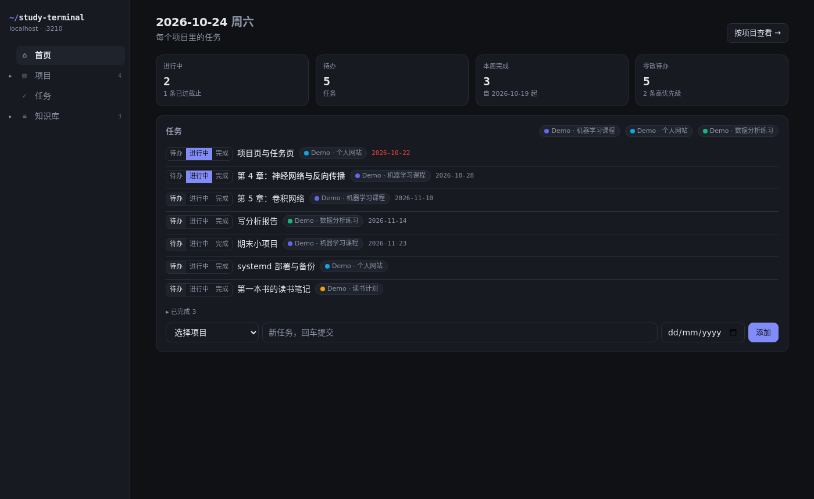
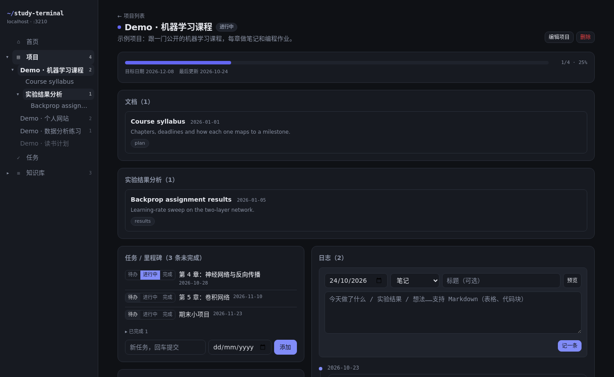

# Study Terminal

A self-hosted study dashboard that runs on your own machine: projects with milestones and a
Markdown log, todos grouped by project, and a file-based knowledge base. One Next.js app, one
SQLite file, no accounts, no cloud.



## Features

| Page | Route | What it does |
|---|---|---|
| Home | `/` | Counters (doing / todo / done this week / loose todos) and every active project's tasks in one list |
| Projects | `/projects`, `/projects/[id]` | Status, ordering, progress bar from milestones, todo → doing → done tasks, Markdown log timeline (tables, code blocks), project docs |
| Tasks | `/todos` | Todos grouped by project, plus a bucket for todos without a project |
| Knowledge base | `/kb` | Markdown files under `content/kb/`, subfolders become sidebar folders |
| Health | `/api/health` | JSON liveness check for monitoring |



## Stack

Next.js 16 (App Router, Server Components, Server Actions) · React 19 · Tailwind CSS 4 ·
SQLite via better-sqlite3 + Drizzle ORM · react-markdown + remark-gfm.

## Quick start

Requires Node.js 20+ on Linux or macOS (the npm scripts use POSIX `VAR=value` syntax).

```bash
git clone <this-repo> study-terminal && cd study-terminal
npm install

# Try it with fictional data (writes ./data/demo.db, never your real DB):
npm run dev:demo            # http://127.0.0.1:3210

# Start for real with an empty database:
cp .env.example .env.local  # set TZ to your timezone
npm run migrate
npm run dev
```

## Configuration

`.env.local` (see `.env.example`):

| Variable | Default | Meaning |
|---|---|---|
| `DB_PATH` | `./data/study.db` | SQLite file, relative to the repo root |
| `TZ` | `UTC` | IANA timezone that decides what "today" is, e.g. `Asia/Shanghai` |

The server listens on `127.0.0.1:3210`. There is **no login**: keep it on localhost and reach it
through an SSH tunnel (`ssh -L 3210:127.0.0.1:3210 you@server`). Only switch `-H` to `0.0.0.0`
in `package.json` on a network you trust.

## Your content

- **Knowledge base**: add `content/kb/**/*.md`. Optional frontmatter: `title`, `date`, `summary`, `tags: [a, b]`.
- **Project docs**: add `content/projects/<project-slug>/*.md` (one level of subfolders allowed).
  They appear on that project's page and in the sidebar.
- **Folder labels**: map folder names to display names in `FOLDER_LABELS`, `src/lib/kb/index.ts`.

The repo ships a few demo files under `content/`; delete them once you add your own. If your
notes are private, add `/content/` to `.gitignore` in your fork.

## Project layout

```
src/
  app/            pages (server components) and /api/health
  actions/        server actions: every write goes through here
  components/     UI; client components are marked "use client"
  db/             schema.ts, client.ts, queries/
  lib/            env, dates, kb (Markdown loader)
scripts/          migrate, seed-demo, e2e
drizzle/          SQL migrations generated from src/db/schema.ts
deploy/           systemd user unit and backup crontab
content/          knowledge base and project docs (Markdown)
docs/             screenshots and the step-by-step build guide
```

## Changing the schema

```bash
# edit src/db/schema.ts, then
npm run db:generate   # writes a new SQL file into drizzle/
npm run migrate       # applies it (also runs automatically before `npm start`)
```

## Deploy as a background service (Linux)

```bash
npm run build
cp .env.example .env.local                      # edit it
sed -e "s|<APP_DIR>|$PWD|g" -e "s|<Your/Timezone>|Asia/Shanghai|" \
  deploy/study-terminal.service > ~/.config/systemd/user/study-terminal.service
systemctl --user daemon-reload
systemctl --user enable --now study-terminal
sudo loginctl enable-linger "$USER"             # keep running after logout
```

After pulling changes: `npm run build && systemctl --user restart study-terminal`.
Nightly backups: see `deploy/crontab.txt`.

## Checks

```bash
npm run typecheck && npm run lint && npm run build

# Browser smoke test (needs Chrome/Chromium; set CHROME_PATH if it is not /usr/bin/google-chrome)
npm run dev:demo                  # in one terminal
npm run e2e                       # in another; screenshots go to data/screenshots/
```

## Build it yourself

`docs/dev-guide.zh.md` (Chinese) walks through building this app from an empty folder in
milestones M0–M7, with the reasoning behind each design choice. It is written so you can hand
it to an AI coding assistant one milestone at a time. Its example names (`study-hub`,
`data/app.db`) differ slightly from this repo.

## License

MIT
